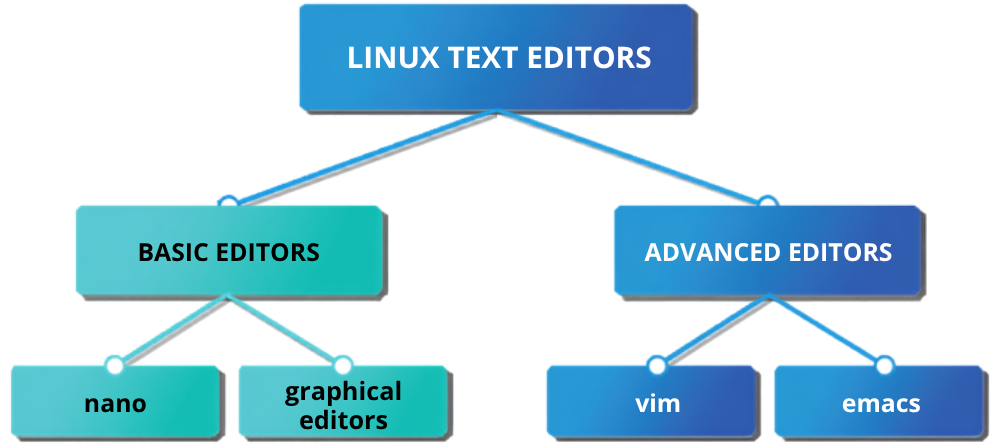

# Linux Text Editors: Master Guide 

If there is one habit that quietly runs through everything you do in Linux, it is editing text. On Linux, the vast majority of the system—from background services to automation scripts—is configured entirely through plain-text files (like those found in the `/etc` directory). Mastering a text editor allows you to reach into nearly any corner of the operating system.

---

## Part 1: Philosophy & Overview

### The Philosophy of Plain Text
It is critical to understand the architectural distinction between a **Plain-Text Editor** and a **Word Processor**. 

A word processor (such as a typical office suite application) is designed for formatting. Behind the scenes, it injects invisible metadata into the file: fonts, margins, styles, and layout information. This is perfect for a report, but it is absolute poison for a Linux configuration file. If you edit a system file in a word processor, that hidden formatting comes along for the ride, corrupting the file and rendering it unusable for its actual purpose. 

A true text editor deals exclusively in raw characters. It saves exactly what you type and absolutely nothing else. If you are coming from Windows or macOS, the closest familiar tools are Notepad or TextEdit operating strictly in plain-text mode.

### The Editor Landscape
Because text editing is so central to the OS, Linux provides a wide variety of editors. They range from highly approachable GUI tools to infinitely customizable terminal environments.



*   **Basic Editors:** Ideal for quick edits and require almost no prior experience.
    *   **Nano:** A straightforward, beginner-friendly editor that runs directly in the terminal. It permanently displays its core commands at the bottom of the screen, requiring almost zero memorization before you can start. 
    *   **Graphical Editors:** Point-and-click editors (like GNOME Text Editor on Ubuntu) that behave exactly like Notepad. This is the natural choice when working in a graphical desktop environment and you want a familiar, mouse-driven experience.
*   **Advanced Editors:** These editors have steeper learning curves but offer immense, scriptable power.
    *   **Vim:** A classic, highly powerful editor installed on virtually *every* Linux and UNIX-like system without exception. Because it is universally present, you will likely land in it unexpectedly, making basic Vim knowledge a mandatory survival skill.
    *   **Emacs:** A long-established, endlessly customizable editor with a loyal user base. It can do far more than edit text, though that massive power comes with its own learning curve.
*   **Modern IDEs:**
    *   **VS Code:** A modern, full-featured Integrated Development Environment (IDE) that many people already know from Windows or macOS. It runs in a graphical desktop environment and is designed for complex source code rather than lightweight configuration tweaks.

### Creating Files Without an Editor (CLI Recap)
For quick file creation or automated shell scripting, you do not need to open a dedicated text editor at all. You can generate files entirely from the command line. *(Note: The mechanics of these commands were covered deeply in the `io-streams-and-terminal.md` documentation).*

*   **Single-Line Creation (`echo >`):** 
    `$ echo "line one" > myfile`
    *(⚠️ **Danger:** The single `>` instantly overwrites the target file with zero confirmation or undo. A mistaken `sudo echo "data" > /etc/somefile` will completely destroy the existing configuration file with no way back. Always double-check your syntax!)*
*   **Appending Data (`echo >>`):**
    `$ echo "line two" >> myfile`
    The double `>>` safely appends the new text to the absolute bottom of the existing file rather than replacing it.
*   **Multi-Line Creation (Here-Documents):**
    Using `cat << EOF > myfile` allows you to write multiple lines directly into a file from the prompt. You type your content, then finish with the `EOF` (End of File) marker on its own line to close the stream.

---

## Part 2: Everyday Text Editing (Nano, GUI, VS Code)

Not every editing task requires the depth of an advanced, infinitely customizable editor like Vim or Emacs. Far more often, you just need to jot down notes, tweak a configuration file, or fix a line in a script. This section covers the highly accessible, everyday editors that allow you to be instantly productive.

### GNU Nano (The Terminal Default)
`nano` is a lightweight, beginner-friendly text editor that runs directly inside your terminal. Its main advantage is immediate accessibility: you do not need to memorize commands before starting because `nano` displays its primary shortcuts along the bottom of the screen at all times.

**Basic Usage:**
To open an existing file or create a new one, pass the filename as an argument:
`$ nano notes.txt`

If the file exists, `nano` opens it. If it does not, `nano` starts a new empty buffer in memory, ready for you to type. You can navigate the document naturally using the arrow keys, Page Up/Down, Backspace, and Delete.

**Nano Keyboard Shortcuts:**
The shortcut bar at the bottom of the screen lists commands formatted with a caret (`^`) followed by a letter. **The `^` symbol represents the `Ctrl` key.**

| Shortcut | Action | Description |
| :--- | :--- | :--- |
| **`Ctrl+O`** | **WriteOut** | Saves the file (press **Enter** to confirm the filename). |
| **`Ctrl+X`** | **Exit** | Closes nano (prompts you to save if changes were made). |
| **`Ctrl+W`** | **Where Is** | Searches for specific text within the file. |
| **`Ctrl+K`** | **Cut Text** | Cuts the current line into the clipboard buffer. |
| **`Ctrl+U`** | **Uncut Text** | Pastes the line from the buffer at your current cursor position. |
| **`Ctrl+G`** | **Get Help** | Opens the built-in help screen. |

> ⚠️ **Editing Protected System Files:**
> Standard users cannot save changes to system-level configuration files (like those in `/etc`). If you open a protected file without administrative privileges, `nano` will display a `[ File is unwritable ]` warning and block you from saving. You must elevate your privileges using `sudo`:
> `$ sudo nano /etc/hosts`

### Desktop GUI Editors
When working within a graphical desktop environment rather than a headless server, you can utilize point-and-click editors that behave identically to Windows Notepad or macOS TextEdit.

*   **GNOME / Ubuntu:** Uses `gnome-text-editor` (or the older `gedit`).
*   **KDE Plasma:** Uses KWrite (simple) or Kate (advanced).

**Launching GUI Apps from the Terminal (`&`):**
You can launch graphical editors straight from the command line:
`$ gnome-text-editor notes.txt &`

**The Background Operator (`&`):** Appending the ampersand (`&`) to the end of a command launches the application in the background. This is crucial for GUI applications; it immediately hands your terminal prompt back to you so you can continue executing commands without having to wait for the graphical editor to be closed.

### Visual Studio Code (`code`)
Visual Studio Code (VS Code) is a modern, full-featured source code editor. It sits squarely between a lightweight text editor (like `nano`) and a massive, heavy Integrated Development Environment (IDE). 

*   **Best Use Case:** While `nano` is faster for tweaking a quick configuration file, VS Code shines when managing multi-file scripting projects, web development, or complex software repositories. 
*   **Extensibility:** It is highly modular. By adding extensions, it gains IDE-like abilities (debugging, integrated version control, and language-specific intelligence).

**Installation & Launching:**
Because VS Code is proprietary Microsoft software, it is not pre-installed on Linux distributions. 

**Installation (Ubuntu/Debian via Snap):**
`$ sudo snap install code --classic`
*(Note: Microsoft also provides official native `.deb` and `.rpm` packages for deeper system integration).*

**Launching an entire project directory:**
Once installed, you can open an entire folder of code directly from the terminal:
`$ code .`
*(The `.` explicitly tells VS Code to open the current working directory).*

---

## Part 3: Advanced Text Editors (`vi` / `vim`)

Alongside approachable editors like `nano`, you will encounter two long-established, highly powerful editors in the Linux world: `vi` and `emacs`. 

Why bother learning them when `nano` is easier? **Because `vi` is installed on virtually every Linux and UNIX-like system, everywhere, without exception.** When you connect to a minimal bare-metal server, recover a broken system, or work on a locked-down cloud instance, `nano` might not be present—but `vi` almost certainly will be. 

Knowing just enough `vi` to open a file, make a change, and save it is an essential survival skill.

> 💡 **A Note on Names (`vi` vs `vim`):** 
> On almost all modern systems (Ubuntu, Debian, RHEL, Fedora), typing `vi` actually executes `vim` ("Vi IMproved"), a modernized and more capable version of the original program. The two names are used interchangeably in practice. *(Note: On stripped-down minimal containers, you may find `vim-tiny` or `vim-minimal`, which lack some extra features but retain all core functionality).*

### The Core Concept: Modal Editing
Unlike a standard word processor or `nano`, **`vi` is modal**. It has completely separate modes for entering text and for issuing commands. The exact same keystroke (like pressing the letter "d") does entirely different things depending on which mode you are currently in. 

Understanding these three modes is the key to mastering `vim`:

1.  **Command Mode (Home Base):** The default mode when `vi` opens. Keystrokes here are interpreted as navigation and editing commands (move the cursor, delete a line, copy text), not as literal text to be typed on the screen.
2.  **Insert Mode:** The mode where you actually type text into the file. You enter it deliberately from Command mode (e.g., by pressing `i`), and you exit it by pressing **`Esc`**.
3.  **Line/Execution Mode:** Used for low-level management commands typed at the absolute bottom of the screen. You enter it from Command mode by typing a colon (`:`).

> ⚠️ **The Golden Rule:** 
> The number one source of beginner confusion is losing track of which mode you are in (resulting in typing text and watching it trigger random commands). **When in doubt, smash the `Esc` key.** `Esc` always returns you to Command mode (Home Base) so you can start fresh.

### Managing Files (Opening, Saving, and Quitting)
To open a file (or create a new one), pass the filename to the editor:
`$ vi configuration.txt`

Once inside, all saving and quitting is done from **Line Mode** (by pressing `:` from Command mode).

| Command | Action | Description |
| :--- | :--- | :--- |
| **`:w`** | Write | Saves the file without exiting. |
| **`:wq`** (or **`:x`**) | Write & Quit | Saves changes and safely exits the editor (the standard way to finish). |
| **`:q`** | Quit | Exits `vi` (this will fail if you have unsaved changes). |
| **`:q!`** | Force Quit | Discards all changes and forces an exit without saving (the `!` means "force it"). |
| **`:r file2`** | Read | Reads `file2` and inserts its contents at your current cursor position. |

### Essential Movement Commands (Command Mode)
While modern `vim` allows you to use standard arrow keys, true `vi` relies on home-row navigation for maximum speed. Ensure you are in Command Mode (`Esc`) before using these:

| Key | Movement Action |
| :--- | :--- |
| **`h`, `j`, `k`, `l`** | Move Left, Down, Up, and Right. |
| **`0`** *(zero)* | Move cursor to the absolute beginning of the current line. |
| **`$`** | Move cursor to the absolute end of the current line. |
| **`w`** / **`b`** | Move forward to the next **w**ord / Move **b**ackward to the preceding word. |
| **`1G`** (or **`:0`**) | Move cursor to the absolute beginning of the file. |
| **`G`** (or **`:$`**) | Move cursor to the absolute last line in the file. |

### Editing and Manipulating Text 
**Entering Insert Mode:**
From Command Mode, you must tell `vi` exactly *how* you want to start typing:
*   **`i`**: **I**nsert text *before* the current cursor position.
*   **`a`**: **A**ppend text *after* the current cursor position.
*   **`o`**: Opens a brand new line *below* the current line and starts inserting text.
*   **`O`**: Opens a brand new line *above* the current line and starts inserting text.

**Deleting Text (Command Mode):**
*   **`x`**: Deletes the single character under the cursor.
*   **`dw`**: Deletes the entire **w**ord at the current position.
*   **`dd`**: Cuts/deletes the entire current line.
*   **`5dd`**: Cuts/deletes the next 5 lines.

**Copying, Pasting, and Undoing (Command Mode):**
*   **`yy`**: **Y**anks (copies) the current line into the buffer.
*   **`p`**: **P**astes the yanked or deleted line *below* the cursor.
*   **`u`**: **U**ndo the previous operation.

### Searching for Text
You can search through massive configuration files rapidly from Command Mode:
*   **`/pattern`**: Searches *forward* through the document for the specified text/pattern (press **Enter**).
*   **`?pattern`**: Searches *backward* through the document.
*   **`n`**: Jumps to the **n**ext occurrence of the search match.
*   **`N`**: Jumps to the previous occurrence of the search match.

### Learning More: `vimtutor`
When you are ready to build muscle memory and move beyond the basics, `vim` includes an excellent built-in, hands-on interactive tutorial. To launch it, open your terminal and type:
`$ vimtutor`

This opens a temporary text file containing an interactive lesson that teaches you commands by having you edit the document itself. It takes about 20 to 30 minutes to complete and is widely considered the single best way to learn `vim`.

*(Note: If your system reports `command not found`, install the full package: `sudo apt install vim` on Debian/Ubuntu or `sudo dnf install vim-enhanced` on Fedora/RHEL).*

---

## Part 4: Advanced Text Editors (`emacs`) & Variables

While `vi` is the undisputed king of pre-installed ubiquity, `emacs` is the other classic UNIX text editor. It has a massive, loyal community and is essentially an entire computing environment built around a text editor. 

### The Core Concept: Modeless Editing
Unlike `vi` (which forces you to switch between Command Mode and Insert Mode), **`emacs` is modeless**. You can type text directly into the file at any time, just like a standard word processor. 

To execute commands (like saving, quitting, or deleting lines), you use specific keyboard combinations instead of switching modes. 

**Understanding `emacs` Key Combinations:**
In official `emacs` documentation, shortcuts rely on two primary modifier keys:
1.  **`C-` (Ctrl):** For example, `C-x` means hold the **Ctrl** key and press `x`.
2.  **`M-` (Meta):** This is usually mapped to your **Alt** key (or pressing the `Esc` key followed by the letter).

### Managing Files (Opening, Saving, and Quitting)
To open a file (or create a new one), pass the filename to the editor:
`$ emacs notes.txt`

| Shortcut | Action | Description |
| :--- | :--- | :--- |
| *(just type)* | **Insert Text** | Directly inserts text into the file buffer. |
| **`C-x C-s`** | **Save** | Holds `Ctrl`, presses `x`, then presses `s` to save the file. |
| **`C-x C-w`** | **Save As** | Writes the file, prompting you for a new filename. |
| **`C-x i`** | **Insert File** | Inserts the contents of a prompted external file at your current cursor position. |
| **`C-x C-c`** | **Quit** | Holds `Ctrl`, presses `x`, then presses `c` to exit (prompts to save if changes were made). |
| **`C-g`** | **Cancel / Abort** | Cancels a half-typed or frozen command (the "get me out of this" button). |

### Movement and Editing Commands
While `emacs` allows standard arrow key navigation, traditional users rely on `Ctrl` combinations to keep their hands on the home row.

**Navigation:**
| Key | Movement Action |
| :--- | :--- |
| **`C-n`** / **`C-p`** | Move to the **n**ext line (down) / **p**revious line (up). |
| **`C-f`** / **`C-b`** | Move **f**orward one character (right) / **b**ackward one character (left). |
| **`C-a`** | Move cursor to the absolute beginning of the line. |
| **`C-e`** | Move cursor to the absolute **e**nd of the line. |
| **`M-f`** / **`M-b`** | Move **f**orward one word / **b**ackward one word. |
| **`M-<`** / **`M->`** | Move to the absolute beginning of the file / absolute end of the file. |

**Text Manipulation:**
| Key | Editing Action |
| :--- | :--- |
| **`C-d`** | **D**eletes the single character at the current cursor position. |
| **`C-k`** | **K**ills (deletes) the rest of the current line. |
| **`C-space`** | Marks the beginning of a selected region of text. |
| **`C-w`** | Deletes the currently marked text and writes it to the buffer (Cut). |
| **`C-y`** | **Y**anks (pastes) the most recently deleted text at the current cursor location. |
| **`C-_`** | Undoes the previous operation. |

**Searching:**
| Key | Search Action |
| :--- | :--- |
| **`C-s`** | **S**earches forward for a specific pattern. |
| **`C-r`** | Searches **r**everse (backward) for a specific pattern. |

### Learning More: Interactive Tutorial
Like `vim`, `emacs` includes a highly regarded interactive built-in tutorial that walks you through basic operations inside the editor itself. 

Once `emacs` is open, launch the tutorial by typing:
**`C-h t`** *(Press `Ctrl + h`, release, then type `t`)*

### Setting Your Default Editor (`$EDITOR` and `$VISUAL`)
Here is something that surprises many newcomers: certain Linux utilities open a text editor automatically on your behalf. For example, when you run `crontab -e` to edit scheduled tasks, or when `git commit` prompts you for a message, the system launches an editor in your terminal. 

**On many enterprise systems, the default choice is `vi`.** If you aren't expecting it, suddenly finding yourself trapped inside `vi` can lead directly to panic.

Which editor these automated commands launch is controlled by two standard environment variables:
*   **`$VISUAL`** — The primary full-screen visual editor preferred by modern programs.
*   **`$EDITOR`** — The legacy/fallback editor variable checked if `$VISUAL` is unset.

**Changing the Default to `nano`:**
Most tools check `$VISUAL` first and fall back to `$EDITOR`. To set your default editor to `nano` for your current session, run:
```bash
$ export VISUAL=nano
$ export EDITOR=nano
```

To ensure all future terminal sessions permanently use your preferred editor, append those exact two export lines to the absolute bottom of your `~/.bashrc` file.

> **⚠️ SysAdmin Pro Tip:**
> Even after permanently setting your default to `nano`, knowing the emergency `vi` exit sequence (`Esc`, then `:q!`) remains a mandatory skill. When logged into a remote bare-metal server or a new user account where environment variables haven't been configured, system utilities will instantly fall back to `vi`.
